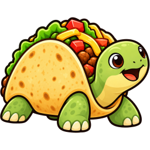
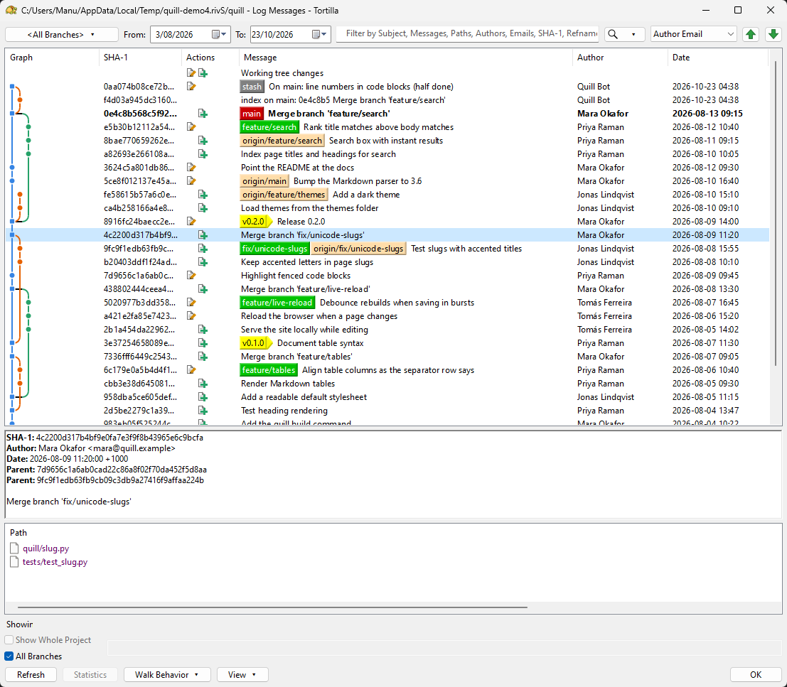

# Tortilla
A native, fast git client that lives in your file manager.

<p align="center">
  
</p>

Tortilla is git where you already are. Right-click a file or folder in
Windows Explorer, or in Nautilus, Dolphin, Nemo, Caja, Thunar or PCManFM on
Linux, and commit, diff, blame or open its history from there. Behind that
menu is a complete history client: a commit graph that scrolls through years
of history without a stutter, interactive rebase, blame, bisect, worktrees and
the rest. And it knows your forge: pull requests and their CI results sit on
your branches, from GitHub, GitLab, Gitea and Forgejo, and you can create,
merge and close them without leaving the log. We think that makes it the most
capable file-manager-integrated git client on any platform.



## Why it's different

- **Native, for real.** Tortilla draws with each desktop's own toolkit: Win32
  on Windows; GTK 4, GTK 3 or Qt 6 on Linux, picked to match your desktop when
  it starts. Your theme, fonts, dark mode and scaling apply, because they're
  the toolkit's own. It's not a web page pretending to be an application.
- **Instant.** Written in C++ on [rapport](https://github.com/TurkeyMan/rapport),
  with libgit2 for reading the repository and git for the work. It opens at
  once, keeps up with a 240 Hz display, and anything slow runs off the UI
  thread.
- **Forge-aware.** A branch with a pull request shows its number and a CI mark
  on its label: passed, failed or running, and whether it can be merged. Hover
  for each check; right-click to open, merge or close it.
- **No setup to sign in.** If the GitHub CLI is signed in, Tortilla uses its
  sign-in as it is. Or sign in through the browser, or with a token, kept in
  your system keychain. Public repositories on github.com, gitlab.com and
  codeberg.org need no sign-in at all.
- **At home if you know TortoiseGit.** Its dialogs and menus, so the muscle
  memory carries over, now on Linux too.

## Features

- **File manager**: TortoiseGit's context menu in Explorer and six Linux file
  managers, with an icon on every entry and each entry's place (top level,
  submenu or hidden) up to you. Badges on file and folder icons show Clean,
  Modified, Conflicted and Added at a glance, in Explorer, Nautilus, Nemo,
  Caja and Dolphin.
- **Log**: the commit graph with branch, tag and remote labels; filters, date
  ranges and a Show menu (current branch, all, local, pull requests, my
  branches, branch tips only, only what's not merged); drag a label onto a
  commit to move the branch, double-click to switch. File and folder history
  that follows renames, and author pictures.
- **Sync**: the log's Fetch button fetches every remote side by side,
  fast-forwards branches you aren't on, and tells you when yours is behind;
  its badge says what a sync would bring before you click.
- **Pull requests**: on their branches' labels with CI marks and tooltips;
  Create Pull Request (offering only valid targets, forks included), Merge and
  Close.
- **Commit** and **Check for modifications**: pick files, amend, set the
  author or date, sign off, and restore a file after committing to split a
  change.
- **History tools**: interactive rebase (pick, squash, edit, skip, drag to
  reorder, add commits from a log), blame with a slider through the file's
  history, bisect, reflog, stash list, Format Patch, Export, the Repository
  Browser and Browse References.
- **Branches and the rest**: branch, tag, switch, merge, reset, stash,
  worktrees and submodules, with the right questions asked when the working
  tree has changes; conflicts in your merge tool.
- **Diff**: a built-in unified diff viewer, or your own tool (WinMerge, Beyond
  Compare, Meld, KDiff3 and more, detected for you); images in IfritView.
- **Remotes**: clone, fetch, pull and push with progress; passwords and host
  keys asked in Tortilla's own window; Git LFS.
- **Accounts**: GitHub, GitLab, Gitea and Forgejo, each checked when you open
  Settings; Settings > Remotes says where you're signed in and why you might
  want to be.

See [CHANGELOG.md](CHANGELOG.md) for the full list. More screenshots, of the
pull request marks, Create Pull Request and Accounts on GTK 4 and Qt 6, are on
[tortillagit.org](https://tortillagit.org).

## Platforms

- **Windows** 10 and 11, x86_64: Win32 throughout, Explorer's context menu and
  icon badges. Tortilla runs git itself, so
  [Git for Windows](https://git-scm.com) needs to be installed.
- **Linux**, x86_64 and arm64: GTK 4, GTK 3 or Qt 6, whichever matches your
  desktop (`--ui=gtk4`, `--ui=gtk3` or `--ui=qt6` to choose; `--which-ui` lists
  what was detected). Context menus for Nautilus, Nemo, Caja, Thunar, Dolphin,
  and PCManFM-Qt and PCManFM; icon badges in Nautilus (beside the icon, or
  after the name in the list), Nemo, Caja and Dolphin. Thunar and PCManFM
  give extensions no way to badge icons.

There's no macOS version.

## Installing

Tortilla 0.1.0 is about to be released. Once it's tagged, the Windows installer
and zip and the Linux packages are on
[GitHub Releases](https://github.com/TurkeyMan/tortilla/releases). Until then,
every [CI run](https://github.com/TurkeyMan/tortilla/actions/workflows/build.yml)
builds the same packages as artifacts, or you can build from source (below).

On Windows, run the installer. It adds Tortilla to Explorer's context menu for
every user, and restarts Explorer (after asking) so the badges show straight
away.

On Linux, there are .deb (Debian, Ubuntu), .rpm (Fedora) and Arch packages.
Install `tortilla`, together with the `tortilla-core` and `tortilla-rapport*`
packages beside it: it carries every user interface and uses the one that
matches your desktop. If you know your desktop's toolkit, you can install just
its package instead: `tortilla-gtk4`, `tortilla-qt` or `tortilla-gtk3`. For
the context menu, add your file manager's: `tortilla-nautilus`,
`tortilla-nemo`, `tortilla-caja`, `tortilla-thunar`, `tortilla-dolphin` or
`tortilla-pcmanfm` (PCManFM-Qt and PCManFM), then restart the file manager. On
Arch you can also build them from a checkout:
`cd packaging/arch && makepkg -si`.

Tortilla carries its own copy of rapport, in `/usr/lib/<arch>/tortilla` (or
`/usr/lib64/tortilla`, `/usr/lib/tortilla`): it never replaces, or is
replaced by, another application's.

PCManFM's menu is a set of files rather than an extension, so when Settings
chooses other top-level or hidden entries, Tortilla writes your own copy to
`~/.local/share/file-manager/actions/tortilla-user*.desktop` (and removes it
when the choices go back to the defaults); restart PCManFM-Qt to see the
change. Uninstalling leaves that copy behind; delete those files by hand.

## Running

Mostly from the file manager's menu; from a terminal:

```sh
tortilla [log] [path]               # the log for the repository holding path
tortilla commit [path...]           # the Commit dialog
tortilla repostatus [path...]       # Check for modifications
tortilla rebase [path] [upstream]
tortilla blame file [rev]
tortilla diff [path] [rev] [rev2]   # no rev: the working tree against HEAD
tortilla pullrequest [path] [branch]
tortilla settings [path] [diff|menu|network|remotes|accounts]
```

`--all` starts the log with all branches. `--register-shell` adds the context
menu for just you, without installing; `--unregister-shell` removes it.
`src/main.cpp` lists every command.

## Building

You need CMake 3.25, a C++23 compiler, libgit2, and the development files
for GTK 3, GTK 4 and/or Qt 6 (Linux) or nothing extra (Windows).

```sh
git clone --recursive https://github.com/TurkeyMan/tortilla.git
cd tortilla
cmake -S . -B build -G Ninja
cmake --build build
build/bin/tortilla log /path/to/a/repo
```

[docs/RELEASING.md](docs/RELEASING.md) says how a release is cut and checked.

## Licence

GPLv3: see [LICENSE](LICENSE), and [NOTICES.md](NOTICES.md) for third-party
notices.

## Credits

Tortilla is built on [rapport](https://github.com/TurkeyMan/rapport), the
native UI library it shares with IfritView (MIT). It follows
[TortoiseGit](https://tortoisegit.org)'s design, with thanks to everyone who
made it.
