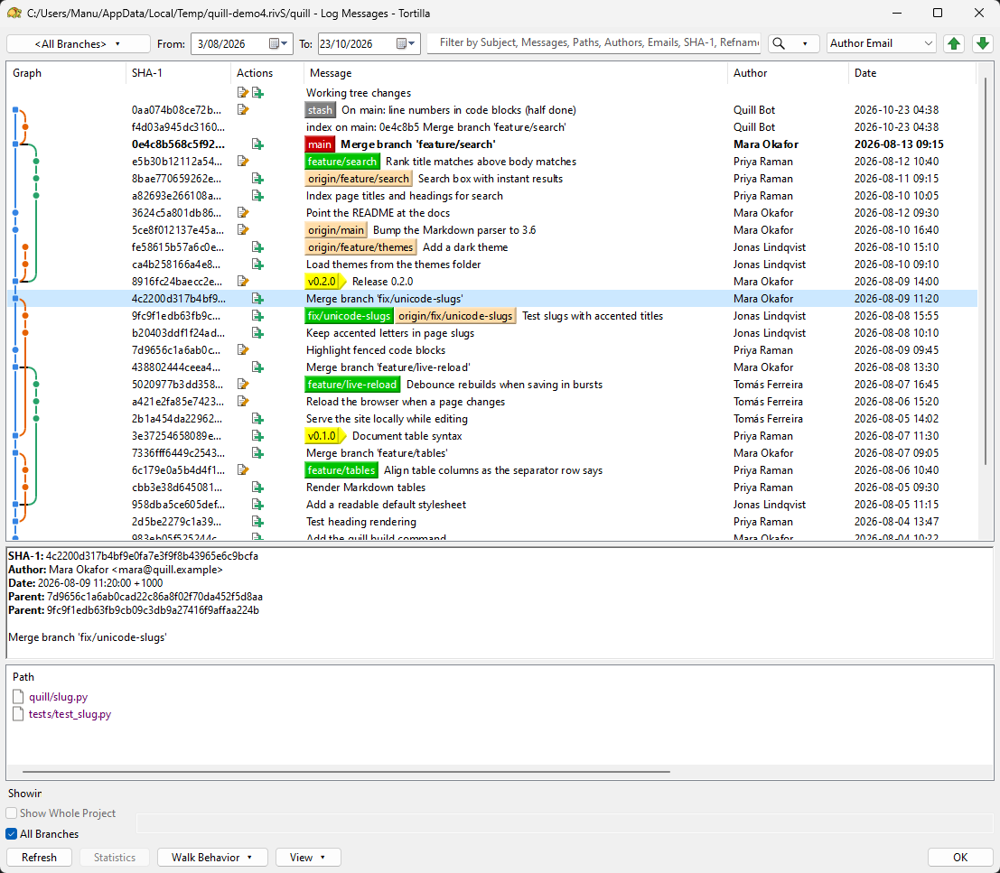

# Tortilla
A fast, native git client for Windows and Linux.

<p align="center">
  
</p>

Tortilla puts your repository's history, branches and changes in front of
you, and keeps up with you as you work through them. It seamlessly adapts to
your platform's own toolkit, for a truly native look and feel everywhere.
It's lightning fast and responsive: it opens in an instant, and scrolls
through years of history without breaking a sweat. It's not a web page
pretending to be an application!



If you've used TortoiseGit, you'll feel at home: Tortilla follows its
dialogs and menus, and now runs on Linux too. It's built on
[rapport](https://github.com/TurkeyMan/rapport).

It's early days. What works now:

- **Log**: the commit graph with branch and tag labels, filters and date
  ranges, the commit details, and the changed files with TortoiseGit's
  context menus. Drag a label onto a commit to move the branch;
  double-click a label to switch to it. Middle-button autoscroll, F5 to
  refresh, and scrolling that keeps up with a 240 Hz display.
- **Rebase**: interactive rebase with pick/squash/edit/skip and reordering.
- **Diff**: a unified diff viewer with find and save, or your own diff tool
  (WinMerge, Beyond Compare, Meld, KDiff3, ...), set in Settings.
- Branches, tags, stash, reset, merge and switching, with the right
  questions asked when the working tree has changes.
- **Explorer**: TortoiseGit's context menu on files and folders, opening
  the log, diff, rebase and settings from where you are. The rest of its
  entries are there, waiting for their dialogs.

## Installing

On Windows, run the installer from the
[releases](https://github.com/TurkeyMan/tortilla/releases). It adds Tortilla
to Explorer's context menu for every user. Tortilla runs git itself, so
[Git for Windows](https://git-scm.com) needs to be installed too.

On Linux, the releases carry .deb (Debian, Ubuntu), .rpm (Fedora) and Arch
packages. Install `tortilla`, together with the `tortilla-core` and
`librapport*` packages beside it: it carries every user interface and uses
the one that matches your desktop. If you know your desktop's toolkit, you can
install just its package instead: `tortilla-gtk4`, `tortilla-qt` or
`tortilla-gtk3`. For the context menu, add your file
manager's: `tortilla-nautilus`, `tortilla-nemo`, `tortilla-caja`,
`tortilla-thunar`, `tortilla-dolphin` or `tortilla-pcmanfm` (PCManFM-Qt and
PCManFM), then restart the file manager. On Arch you can also build them from
a checkout: `cd packaging/arch && makepkg -si`.

PCManFM's menu is a set of files rather than an extension, so when Settings
chooses other top-level or hidden entries, Tortilla writes your own copy to
`~/.local/share/file-manager/actions/tortilla-user*.desktop` (and removes it
when the choices go back to the defaults); restart PCManFM-Qt to see the
change. Uninstalling leaves that copy behind; delete those files by hand.

## Running

```sh
tortilla [log] [path]           # the log for the repository holding path
tortilla rebase [path] [upstream]
tortilla diff [path] [rev] [rev2]  # no rev: the working tree against HEAD
tortilla settings [path]
```

`--all` starts the log with all branches; `--ui=gtk3`, `--ui=qt6` and so on
pick the toolkit (`--which-ui` lists what was detected).
`--register-shell` adds the context menu for just you, without installing;
`--unregister-shell` removes it.

## Building

You need CMake 3.25, a C++23 compiler, libgit2, and the development files
for GTK 3, GTK 4 and/or Qt 6 (Linux) or nothing extra (Windows).

```sh
git clone --recursive https://github.com/TurkeyMan/tortilla.git
cd tortilla
cmake -S . -B build -G Ninja
cmake --build build
build/bin/tortilla log /path/to/a/repo
```

## Licence

GPLv3: see [LICENSE](LICENSE). Tortilla follows TortoiseGit's design;
rapport, the UI library, is MIT.
